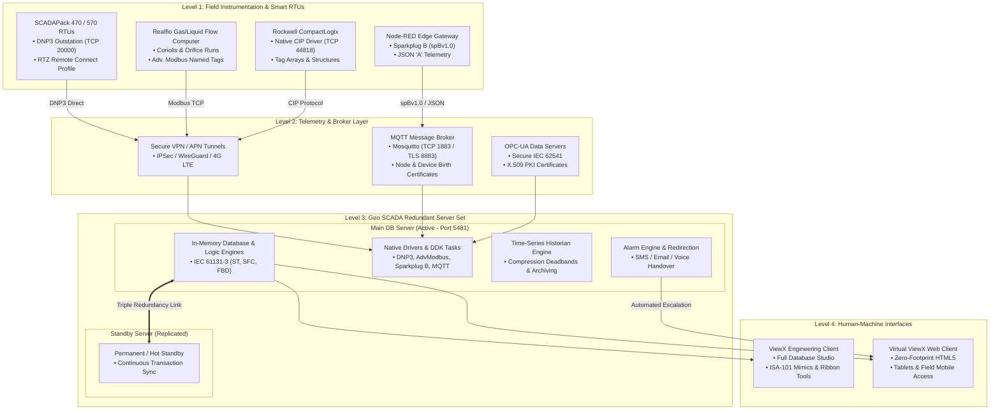

# ⚡ EcoStruxure Geo SCADA Field Engineering Guide (PWA)

[](https://githubbest729.github.io/ecostruxure-geoscada-field-guide/)
[](https://www.se.com/)
[](https://githubbest729.github.io/ecostruxure-geoscada-field-guide/#dnp3)
[](https://githubbest729.github.io/ecostruxure-geoscada-field-guide/#t3)
[](LICENSE)

An offline-first, mobile-responsive **Progressive Web App (PWA)** and operational handbook for Schneider Electric **EcoStruxure Geo SCADA Expert** (formerly ClearSCADA), engineered specifically for **** automation and field telemetry projects.

---

## 📑 Table of Contents

- [⚡ EcoStruxure Geo SCADA Field Engineering Guide (PWA)](#-ecostruxure-geo-scada-field-engineering-guide-pwa)
  - [📑 Table of Contents](#-table-of-contents)
  - [🎯 Overview \& Highlights](#-overview--highlights)
  - [🏗️ End-to-End System Architecture](#️-end-to-end-system-architecture)
  - [📚 Engineering Procedures \& Tutorials](#-engineering-procedures--tutorials)
    - [Core Procedures](#core-procedures)
    - [Extended DNP3 \& IoT Protocols](#extended-dnp3--iot-protocols)
    - [Modular Mimic \& Screen Creation](#modular-mimic--screen-creation)
  - [📖 Comprehensive Glossary \& Architecture Topics](#-comprehensive-glossary--architecture-topics)
  - [🖼️ Application Screenshots \& Interactive Preview](#️-application-screenshots--interactive-preview)
  - [📁 Complete Repository File Inventory](#-complete-repository-file-inventory)
  - [🎨 Icon Set \& Visual Assets](#-icon-set--visual-assets)
  - [🚀 GitHub Pages Deployment Guide](#-github-pages-deployment-guide)
  - [🔄 Cache Management \& Version Bumping](#-cache-management--version-bumping)
  - [⚠️ Field Standards \& Safety Disclaimer](#️-field-standards--safety-disclaimer)

---

## 🎯 Overview & Highlights

- **Zero-Build & Zero-Dependency:** Plain semantic HTML5, modern responsive CSS variables, and Vanilla JavaScript. Runs directly in any modern browser without npm build steps.
- **Offline-First PWA:** Implements Service Worker pre-caching and runtime cache strategies so field engineers can access telemetry wiring, DNP3 point tables, and diagnostic steps deep in pump station basements or desert substations without cell signal.
- **Touch-Friendly & WCAG AA Compliant:** Responsive CSS Grid/Flexbox layouts with touch targets $\ge 44 \times 44\text{ px}$, dark/light SCADA theme switching, and safe-area notch padding (`env(safe-area-inset-*)`).
- **Interactive ISA-101 Mimic Sandbox:** Live in-app testing component demonstrating high-performance grayscale graphics, dynamic point animations, quality badges, and pick-action context menus.

---

## 🏗️ End-to-End System Architecture

The following diagram illustrates the complete telemetry topology implemented across **** projects, connecting field smart devices, IoT edge brokers, and redundant Geo SCADA host servers:



---

## 📚 Engineering Procedures & Tutorials

### Core Procedures
1. **Tutorial 1 · Database Hierarchy & Template Instantiation:**
   - Setting up root group conventions (`AGAC.DXB.WPS01.Pump1.Run`).
   - Standardizing asset tags, site numbering, and human-readable descriptions.
   - Creating master Group Templates and binding Group Instances.
2. **Tutorial 1B · Advanced Templates & Instantiation:**
   - Building multi-tier nested templates (`Template_Pump` nested inside `Template_PumpStation`).
   - Unlocking Property Overrides for RTU IP endpoints and instrument calibration limits.
   - Live template propagation testing ("Changes to templates").
   - Creating Free-Standing Objects for unique, site-specific instrumentation.
3. **Tutorial 2 · Driver Configuration & Outstation Telemetry:**
   - Creating Direct Channels (TCP/IP Port `20000` for DNP3, Port `502` for Modbus TCP).
   - Binding Outstation Sets, Direct Outstations, and polling parameters.
   - Raw analog scaling (ADC counts `0–32767` $\rightarrow$ engineering range `0.0–5.0 m`).
4. **Tutorial 3 · Interactive Mimics & High-Performance HMI:**
   - Implementing ISA-101 situational awareness (neutral gray canvas, shape + text alert cues).
   - Configuring animations (Fill, Outline, Size/Scale, and visibility).
   - Binding Pick Actions for Object Menus, Faceplates, and Trend displays.
5. **Tutorial 4 · Alarm Prioritization, Redirection & Event Actions:**
   - Configuring 4-tier alarm matrices (Critical, High, Medium, Low).
   - Setting unacknowledged escalation rules with automatic SMS/email redirection.
   - Safe alarm suppression procedures during field commissioning.
6. **Tutorial 5 · Commissioning, Diagnostics & Server Status:**
   - Utilizing Server Status tool to review DB cache, write locks, and memory health.
   - Activating driver communications logging and packet decoding.
   - Executing point hand controls and dry-loop testing.

### Extended DNP3 & IoT Protocols
- **DNP3 Implementation Guide (`#dnp3`):** Complete walkthrough for Direct Channels, Direct Outstation Sets, Generic/SCADAPack Outstations, Class 0 integrity polls (`15M`), Class 1/2/3 event scans (`5S`), and Select-Before-Operate (SBO) command mappings.
- **SCADAPack x70 Upload Revolution:** Importing `.rtz` packages exported from Schneider Electric Remote Connect to automatically generate Geo SCADA database trees.
- **Sparkplug B & Node-RED Simulation:** Setting up `spBv1.0` brokers, auto-discovering device metric dictionaries from `DBIRTH` packets, and injecting test vectors using Node-RED.
- **Native Rockwell CIP Integration:** Parameterizing Ethernet/IP channels for Allen-Bradley ControlLogix and CompactLogix PLCs without third-party OPC servers.

### Modular Mimic & Screen Creation
- **Tutorial 3B · Embedded Symbols (`Pump.Symbol`):** Creating self-contained graphic components with relative dot notation (`.Status`, `.Flow`) to embed cleanly onto overview screens.
- **Tutorial 3C · Parameterized Faceplates:** Building generic diagnostic popups driven by string parameters (`PumpPath = "AGAC.DXB.WPS01.Pump2"`).
- **Procedure 9 · Bulk Site Duplication:** Replicating station groups in seconds using ViewX **Edit $\rightarrow$ Find & Replace DB References**.

---

## 📖 Comprehensive Glossary & Architecture Topics

The app includes an extensive offline-searchable glossary covering more than 60 industrial SCADA terms:

| Category | Key Concepts Covered |
|:---|:---|
| **Server Architecture** | Main/Standby Redundancy, Triple Standby, Permanent Standby, DB Server Port 5481, Lock Diagnostics, Data File Cache |
| **Client Environments** | ViewX Engineering Client, Virtual ViewX (HTML5), Ribbon Workspace (Home, Edit, Graphics, View) |
| **Database Model** | Root Groups, Group Templates, Group Instances, Property Overrides, Free-Standing Objects, Nested Blueprints |
| **DNP3 Protocol** | Class 0/1/2/3 Scanning, Unsolicited Messages, IIN Internal Indications, CROB Controls, SBO, WITS Standards |
| **MQTT & IoT** | MQTT Broker (Port 1883/8883), JSON 'A', Sparkplug B (`spBv1.0`), `NBIRTH`/`DBIRTH`/`DDEATH`, `mosquitto_pub` CLI |
| **Flow Metering** | Realflo EFM, Coriolis Mass Flow, Gas Flow Run Objects, Low Flow Cutoff, Linearization Scaling |
| **Diagnostics & Status** | Driver Point Updates ("Top 25" noisy tags), `DBStartup_001.log`, Process Count, Quality Badges (F, H, O, U) |

---

## 🖼️ Application Screenshots & Interactive Preview

| Module | Description | Interface Preview |
|:---|:---|:---:|
| **ISA-101 Mimic Sandbox** | Real-time interactive canvas demonstrating situational awareness design, pump status toggling, and wet-well animations. | `Interactive PWA Preview` |
| **ViewX Ribbon Glossary** | Direct mapping of tools across Home, Edit, Graphics, and View ribbons with  configuration examples. | `Searchable Glossary` |
| **DNP3 Step-by-Step** | 4-tier tree architecture with configuration tabs and field parameter matrices. | `DNP3 Execution Guide` |
| **Diagnostic Terminal** | Practical examples of `mosquitto_sub` and `mosquitto_pub` command syntax for packet simulation. | `CLI Reference Guide` |

---

## 📁 Complete Repository File Inventory

```text
ecostruxure-geoscada-field-guide/
├── index.html              # PWA shell, sidebar/bottom navigation, searchable glossary & all tutorials
├── styles.css              # Industrial dark/light theme tokens, fluid typography, safe-area padding
├── app.js                 # Dynamic search engine, hash routing, install banner, mimic interactive sandbox
├── sw.js                  # Service Worker precaching, stale-while-revalidate strategy, cache versioning
├── manifest.webmanifest   # PWA manifest declaring standalone display, scope, theme colors & icon list
├── offline.html           # Dedicated offline fallback page for uncached network requests
├── favicon.ico            # Multi-resolution browser tab icon
├── favicon.svg            # Scalable vector favicon
├── apple-touch-icon.png   # iOS home screen touch icon (180x180 px)
└── icons/                 # Complete PWA install & splash icon suite
    ├── icon-192.png       # Android home screen icon (192x192 px)
    ├── icon-512.png       # Splash screen and Web Store icon (512x512 px)
    ├── icon-maskable-192.png  # Adaptive icon for modern Android launchers
    └── icon-maskable-512.png  # High-DPI adaptive icon
```

---

## 🎨 Icon Set & Visual Assets

To ensure 100% compliance with Google Lighthouse PWA audits and Apple iOS Web Clip specifications, place the following icon set into your `/icons/` directory:

| Filename | Dimensions | Purpose |
|:---|:---:|:---|
| `favicon.ico` | $16\times 16$, $32\times 32$, $48\times 48$ | Standard browser tab icon |
| `favicon.svg` | Scalable Vector | High-resolution modern desktop browser address bars |
| `apple-touch-icon.png` | $180\times 180\text{ px}$ | iOS Home Screen bookmark icon |
| `icon-192.png` | $192\times 192\text{ px}$ | Standard Android launcher icon (PWA requirement) |
| `icon-512.png` | $512\times 512\text{ px}$ | PWA install prompt banner and splash screen |
| `icon-maskable-192.png` | $192\times 192\text{ px}$ | Adaptive Android launcher icon (safe-zone centered) |
| `icon-maskable-512.png` | $512\times 512\text{ px}$ | Adaptive splash icon for Android 12+ devices |

---

## 🚀 GitHub Pages Deployment Guide

Deploying the guide takes less than two minutes:

1. **Clone or Download the Repository:**
   ```bash
   git clone https://github.com/githubbest729/ecostruxure-geoscada-field-guide.git
   cd ecostruxure-geoscada-field-guide
   ```

2. **Commit Your Files:**
   Ensure `index.html`, `styles.css`, `app.js`, `sw.js`, and `manifest.webmanifest` are present in the repository root.
   ```bash
   git add .
   git commit -m "feat: complete Geo SCADA PWA field guide and tutorials"
   git push origin main
   ```

3. **Enable GitHub Pages:**
   - Go to your repository on GitHub: **Settings $\rightarrow$ Pages**.
   - Under **Build and deployment $\rightarrow$ Source**, select **Deploy from a branch**.
   - Select Branch: **`main`** and Folder: **`/(root)`**.
   - Click **Save**.

4. **Verify Offline Access:**
   - Navigate to `https://githubbest729.github.io/ecostruxure-geoscada-field-guide/` in Chrome, Safari, or Edge.
   - Open DevTools (**F12**) $\rightarrow$ **Application** $\rightarrow$ **Service Workers** and verify status: `Activated and running`.
   - Check the **Offline** box in Network tab; refresh the page to confirm complete offline operation!

---

## 🔄 Cache Management & Version Bumping

When pushing updates to tutorials, scripts, or styles, open `sw.js` and increment the cache version token:

```javascript
// sw.js
const CACHE_NAME = 'geoscada-guide-v1.5.0'; // <-- Bump this version string
const PRECACHE_URLS = [
  './',
  './index.html',
  './styles.css',
  './app.js',
  './manifest.webmanifest',
  './offline.html',
  './favicon.svg',
  './apple-touch-icon.png'
];
```

The Service Worker will automatically install the new cache in the background and purge obsolete files upon the user's next visit.

---

## ⚠️ Field Standards & Safety Disclaimer

> **IMPORTANT SAFETY NOTICE**
> 
> Configuration parameters, TCP port numbers, memory offsets, and alarm thresholds documented in this guide represent **** engineering standards. Always verify parameters against manufacturer submittals, client specifications, and the Schneider Electric Geo SCADA documentation for your specific software release.
> 
> **Never perform remote hand controls, point forcing, or template schema alterations on a live production SCADA server without an approved Permit to Work (PTW) and client operational clearance.**

---

*Authored by  SCADA Systems Engineering Team · Independent Technical Reference (Not an official Schneider Electric publication).*
